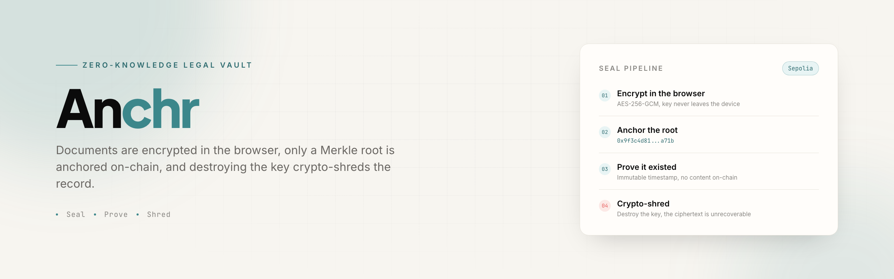
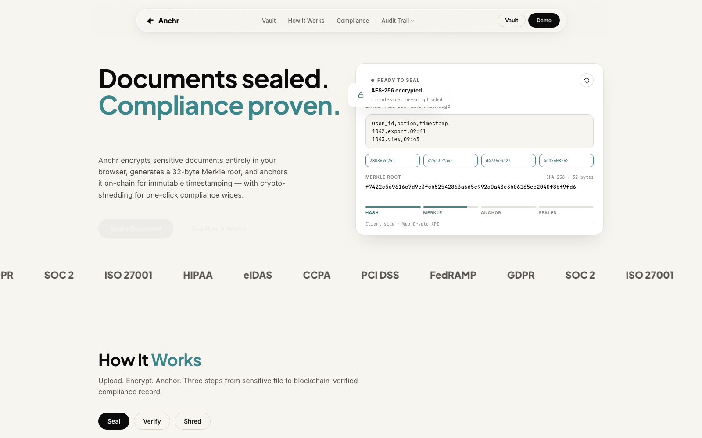
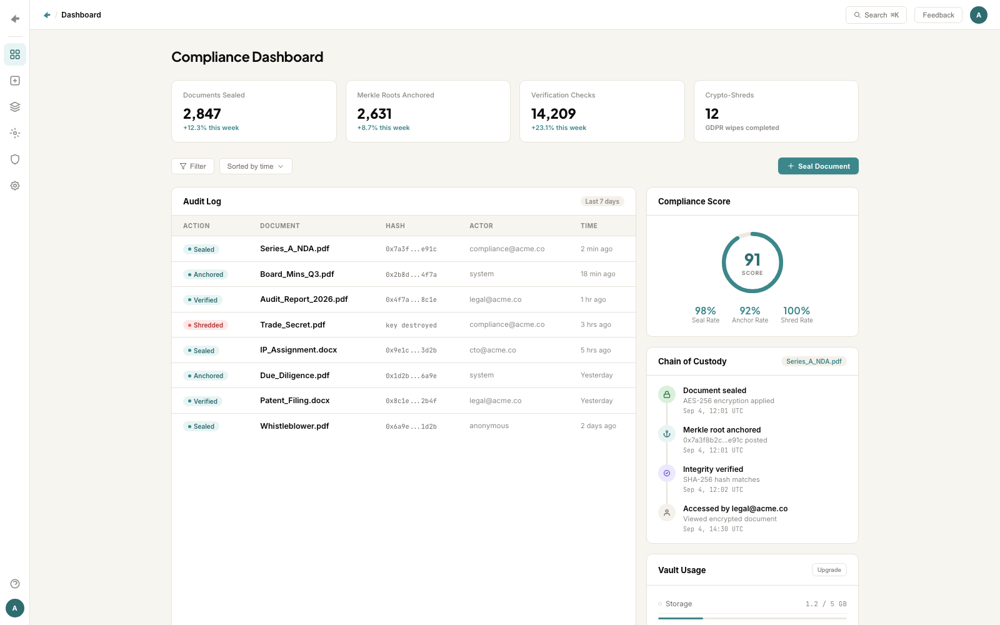
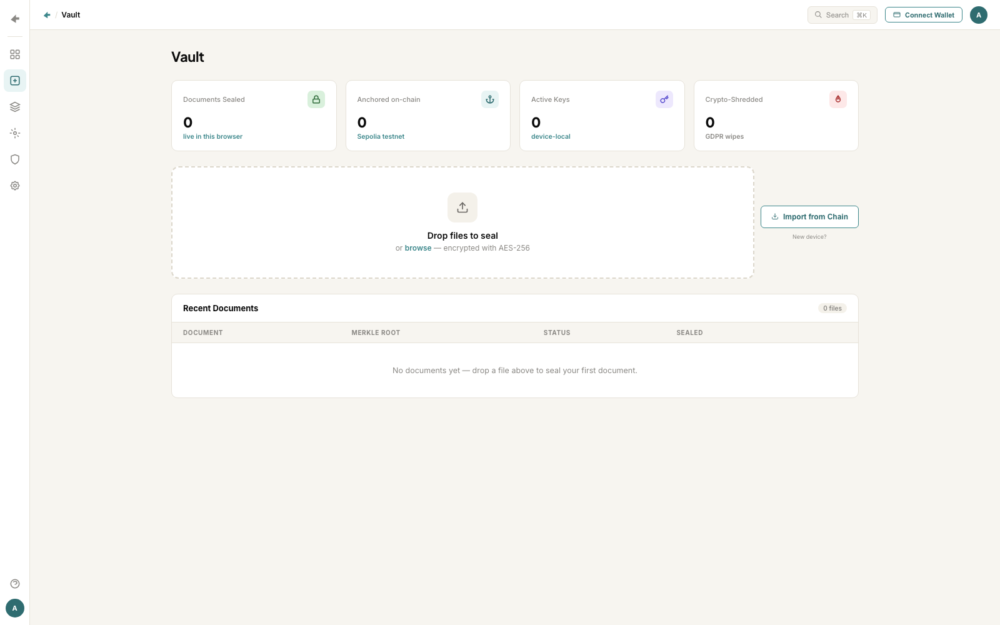
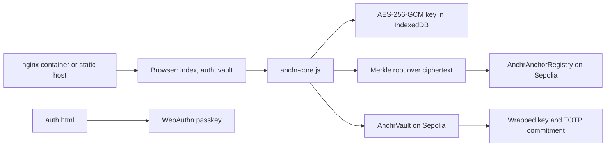

<p align="center">
  
</p>

<p align="center">
  <a href="https://github.com/maxxexee/anchr/actions/workflows/test.yml"></a>
  <a href="https://github.com/maxxexee/anchr/actions/workflows/check.yml"></a>
  <a href="LICENSE"></a>
  <a href="src/AnchrAnchorRegistry.sol"></a>
  <a href="https://sepolia.etherscan.io/address/0xaeEFEA4E261f82b686c9caeeeE9a9a7738D25db6"></a>
  <a href="anchr-core.js"></a>
</p>

Anchr is a zero-knowledge vault for legal documents. A file is encrypted in the browser, a Merkle root is computed over the ciphertext, and only that root is anchored on-chain. The document itself never leaves the device, and destroying the key crypto-shreds the record.

> **Prototype.** The contracts are deployed on Sepolia and the browser flows run, but nothing here is audited. The hosted demo is offline. When no wallet or signing key is available the anchor step writes a local mock record instead of a transaction, so treat an anchor as unproven unless it has a transaction hash you can open on Etherscan.

## Contents

- [Why this exists](#why-this-exists)
- [What it does](#what-it-does)
- [Screens](#screens)
- [Pages](#pages)
- [How it works](#how-it-works)
- [Architecture](#architecture)
- [Contracts](#contracts)
- [Browser crypto](#browser-crypto)
- [Identity and key recovery](#identity-and-key-recovery)
- [Verification](#verification)
- [Tech stack](#tech-stack)
- [Repository layout](#repository-layout)
- [Quickstart](#quickstart)
- [Docker](#docker)
- [Environment variables](#environment-variables)
- [Scripts](#scripts)
- [Known gaps](#known-gaps)
- [Roadmap](#roadmap)
- [Security](#security)
- [Contributing](#contributing)
- [License](#license)

## Why this exists

A legal team needs to prove a document existed at a point in time without handing the document to a chain, a vendor, or an adversary who can subpoena it later. Uploading to a shared drive proves nothing and creates a copy you cannot take back.

Anchr separates the two things that are usually fused: the content and the proof. The content stays encrypted on the client. The proof is a 32-byte root that anyone can verify. Destroying the key makes the ciphertext permanently unreadable, which is what a lawful erasure request actually needs.

## What it does

- Encrypts a file in the browser with AES-256-GCM and keeps the key on the device.
- Computes a Merkle root over 32-byte chunks of the ciphertext, not the plaintext.
- Anchors the root in `AnchrAnchorRegistry` on Sepolia.
- Verifies a stored document by recomputing the root from the ciphertext.
- Seals the encrypted payload, wrapped key, and TOTP commitment into `AnchrVault` for cross-device recovery.
- Crypto-shreds a document by destroying the key and deleting the on-chain record.
- Signs users in with a WebAuthn passkey, so there is no password and no server-side session.

## Screens

| Landing | Compliance dashboard |
| --- | --- |
|  |  |

| Vault | |
| --- | --- |
|  | The vault shows an empty state because documents live in the browser's IndexedDB. A fresh profile starts at zero. |

The dashboard numbers are built-in sample data. The vault counts are real local state.

## Pages

| Page | What it does |
| --- | --- |
| `index.html` | Landing page, the seal demo, and the compliance framing |
| `auth.html` | Passkey registration and sign-in |
| `dashboard.html` | Audit log, compliance score, and chain of custody with sample data |
| `vault.html` | Drop a file to seal it, list sealed documents, fetch, verify, and shred |

## How it works

1. The user drops a file in `vault.html`.
2. `anchrSeal` generates an AES-256-GCM key, encrypts the bytes, and packs the IV with the ciphertext.
3. The Merkle root is computed over the ciphertext so the root commits to the sealed bytes.
4. The encrypted blob and its metadata are written to IndexedDB.
5. `anchrAnchor` sends `anchor(bytes32)` to the registry on Sepolia, then records the transaction hash.
6. `anchrVerify` recomputes the root from the stored ciphertext and compares it with the anchored root.
7. `anchrShred` deletes the local record and drops the key, and the vault contract deletes the on-chain copy.

Anchoring tries three paths in order: direct signing with a session key, then MetaMask, then a local mock record that is clearly not a transaction. Only the first two produce an Etherscan link.

## Architecture



There is no application server. The container serves static files, and the chain plus the browser do the rest.

## Contracts

| Contract | Address on Sepolia | Purpose |
| --- | --- | --- |
| `AnchrAnchorRegistry` | `0xaeEFEA4E261f82b686c9caeeeE9a9a7738D25db6` | Stores Merkle roots with sender, timestamp, and sequence |
| `AnchrVault` | `0xc1eDa79d2Fd90F0630AB29A16D59F68f0A2F7C9e` | Stores encrypted payloads, wrapped keys, and TOTP commitments |

`AnchrAnchorRegistry`:

- `anchor(bytes32 root)` rejects an empty root and a root that is already anchored, then emits `RootAnchored`.
- `verify(bytes32 root)` returns whether the root exists and its full anchor record.
- `count()` returns the number of anchored roots.

`AnchrVault`:

- `seal(...)` stores the ciphertext, the wrapped key, and the TOTP commitment, and indexes the document by sender.
- `fetch(bytes32 id)` returns the payload and the wrapped key, and refuses a shredded document.
- `shred(bytes32 id)` requires the original sender and deletes the payload, the wrapped key, and the commitment.

## Browser crypto

All of it lives in `anchr-core.js` and runs on Web Crypto.

| Step | Primitive |
| --- | --- |
| Document encryption | AES-256-GCM, random IV, IV packed with the ciphertext |
| Content commitment | Merkle tree over SHA-256 hashes of 32-byte chunks |
| Key wrapping | PBKDF2 from the TOTP secret, then AES-GCM over the document key |
| Sign-in | WebAuthn passkey, no password and no server session |
| Local storage | IndexedDB, one record per document |

The Merkle root commits to the ciphertext. If a single byte of the stored blob changes, verification fails.

## Identity and key recovery

A passkey proves the same person is back on a new device. The TOTP secret that wraps the document key is created when a document is sealed, and the vault page can display it so a user can copy it to an authenticator. That is the recovery path: passkey for presence, TOTP secret for key material. Losing both means the ciphertext stays sealed forever, which is the intended property.

## Verification

| Check | Surface | Result |
| --- | --- | --- |
| Formatting | `forge fmt --check` | Clean |
| Build | `forge build --sizes` | Contract sizes reported |
| Contract tests | `forge test -vvv` | 15 tests |
| Repository checks | `node scripts/check-repo.mjs` | Required files, README links, image sizes, no committed keys |
| Deployed registry | Sepolia | Live at the address above |
| Deployed vault | Sepolia | Live at the address above |
| Hosted demo | Render | Offline |
| Audit | None | Not audited |

Run the contract suite:

```bash
forge test -vvv
```

## Tech stack

| Layer | Technology |
| --- | --- |
| Contracts | Solidity 0.8.20, Foundry, forge-std |
| Browser crypto | Web Crypto, AES-256-GCM, SHA-256, PBKDF2, IndexedDB |
| Chain access | ethers v6, Sepolia, EIP-7702 delegation check |
| Identity | WebAuthn passkeys, TOTP |
| Hosting | nginx alpine container on port 10000 |
| CI | GitHub Actions |

## Repository layout

```text
.
├── index.html            Landing page and seal demo
├── auth.html             Passkey registration and sign-in
├── dashboard.html        Compliance dashboard with sample data
├── vault.html            Seal, list, verify, and shred documents
├── anchr-core.js         Browser crypto, storage, anchoring, passkeys
├── src/                  AnchrAnchorRegistry.sol and AnchrVault.sol
├── script/               Deploy scripts for both contracts
├── test/                 Foundry tests for both contracts
├── e2e-*.mjs             End-to-end scripts for anvil, Sepolia, and the browser flow
├── docs/
│   ├── assets/           Banner, social preview, screenshots
│   └── brand.html        Source artboards for the image assets
├── scripts/              Repository checks
├── .github/              Issue forms, PR template, CI, Dependabot
├── Dockerfile            nginx image serving the static site
├── nginx.conf            Static config with SPA fallback on port 10000
└── foundry.toml          Foundry config
```

## Quickstart

Requirements: Node.js 20 or newer, Foundry, and a browser with Web Crypto.

```bash
git clone https://github.com/maxxexee/anchr.git
cd anchr
git submodule update --init --recursive
npm ci
python3 -m http.server 8080
```

Open `http://localhost:8080`. Use `localhost` or HTTPS, because the passkey and crypto APIs require a secure context.

Single page shortcuts: `/index.html`, `/auth.html`, `/vault.html`, `/dashboard.html`.

## Docker

```bash
docker build -t anchr .
docker run --rm -p 10000:10000 anchr
```

Then open `http://localhost:10000`. The image copies `*.html` and `*.js` into an nginx document root, so rebuild after changing the frontend.

## Environment variables

The frontend needs no environment variables. The scripts read these:

| Variable | Required | Description |
| --- | --- | --- |
| `SEPOLIA_RPC_URL` | For deploy scripts | Sepolia RPC endpoint |
| `PRIVATE_KEY` | For deploy scripts | Deployer key, use a throwaway testnet key |
| `ANCHOR_ADDRESS` | For `e2e-test.mjs` | Registry address to exercise, defaults to the local anvil address |
| `ANVIL_PRIVATE_KEY` | No | Overrides the public anvil account 0 key used to fund a local wallet |

See [.env.example](.env.example) for the same list.

## Scripts

| Command | Description |
| --- | --- |
| `forge build` | Compile the contracts |
| `forge test -vvv` | Run the Foundry tests |
| `forge fmt --check` | Verify formatting |
| `node scripts/check-repo.mjs` | Run repository checks |
| `node e2e-test.mjs` | Exercise the registry against a local anvil node |
| `node e2e-sepolia.mjs` | Exercise the flow against Sepolia |
| `node e2e-vault.mjs` | Exercise the vault seal and fetch path |
| `node e2e-totp-login.mjs` | Exercise the TOTP login path |
| `node e2e-browser-flow.mjs` | Exercise the browser flow end to end |

The deploy scripts live in `script/`:

```bash
forge script script/DeployAnchr.s.sol --rpc-url $SEPOLIA_RPC_URL --private-key $PRIVATE_KEY --broadcast
forge script script/DeployVault.s.sol --rpc-url $SEPOLIA_RPC_URL --private-key $PRIVATE_KEY --broadcast
```

## Known gaps

- The hosted demo on Render is offline, so there is no public URL right now.
- The anchor step falls back to a local mock record when no signing path is available. A mock anchor is not a transaction and proves nothing on-chain.
- The dashboard figures, audit log, and chain of custody are built-in sample data, not a queried index.
- Browser crypto, storage, and anchoring have no automated tests. Only the contracts are covered.
- The direct signing path keeps a private key in session storage for the session.
- The TOTP secret is displayed in the UI for recovery, so anyone with the unlocked browser can copy the key material.
- The contracts are not audited, and the registry has no admin or migration path.
- The frontend loads ethers from a CDN with no integrity pin.

## Roadmap

- Add a browser-side test suite for seal, verify, and shred with a mocked provider.
- Replace the mock anchor fallback with an explicit failure state.
- Add subresource integrity and a pinned ethers build.
- Index anchors into a read API so the dashboard shows real data.
- Get an external review of the vault contract and the key wrap.

## Security

This is a prototype. Do not seal real client documents, do not use a funded deployer key, and do not treat a displayed root as legal evidence without a transaction hash.

Report vulnerabilities privately using the process in [SECURITY.md](SECURITY.md). Do not open a public issue for a security problem.

## Contributing

Read [CONTRIBUTING.md](CONTRIBUTING.md) before opening a pull request. Run:

```bash
forge fmt --check
forge build --sizes
forge test -vvv
node scripts/check-repo.mjs
```

Keep the README and docs free of emojis and em dashes.

## License

MIT License. See [LICENSE](LICENSE).
